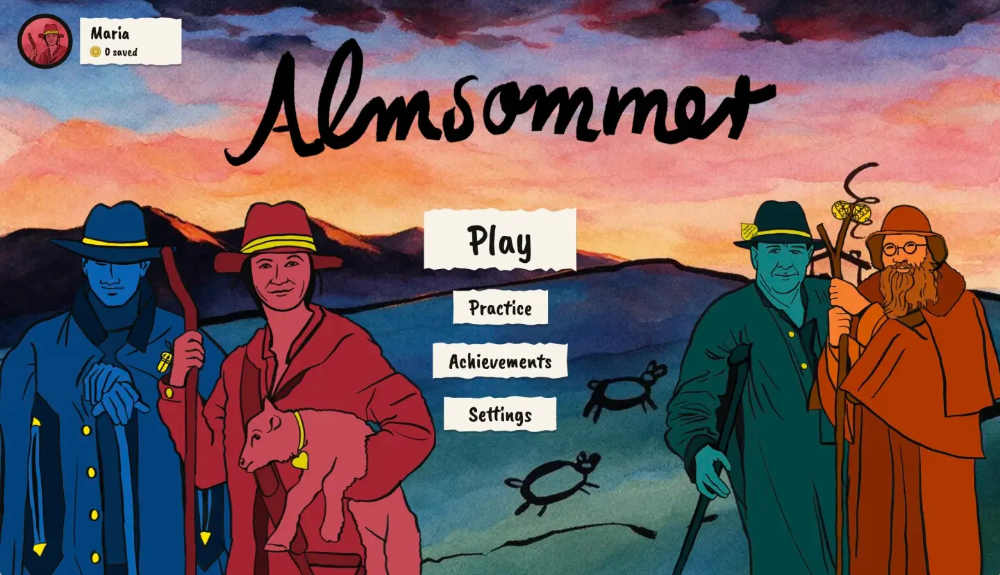
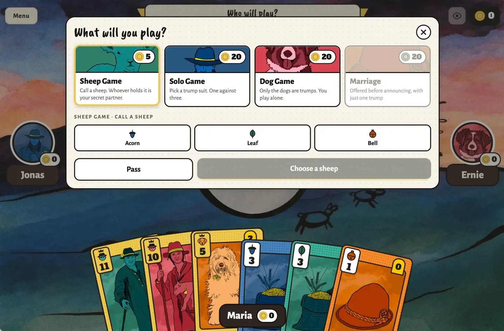
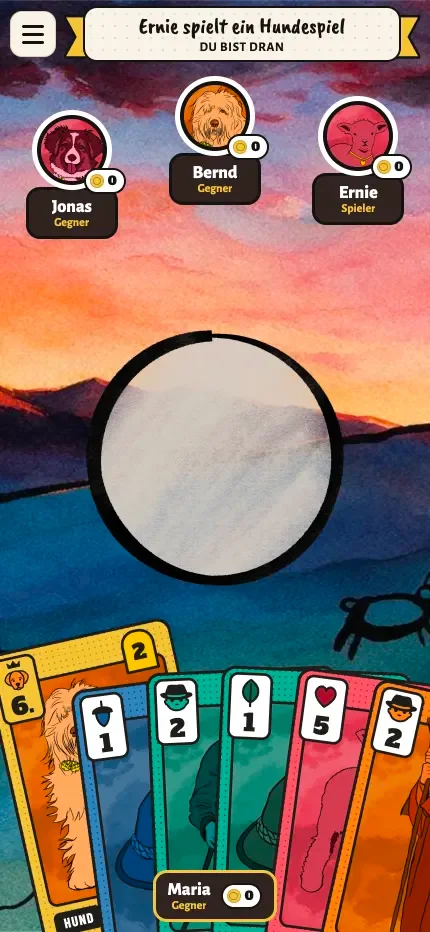

# Almsommer – Schafkopf on an alpine meadow

**[Play in the browser](https://almsommer.mariathurn.de/)** · Coming soon to Google Play



Almsommer is the Bavarian card game Schafkopf as an app for Android, iOS and the web. You play against three
computer opponents, and a guided first game and practice rounds help new players learn the rules.

It's my favourite card game, and I wanted to make it easier for people outside Bavaria to learn – so I have
more people to play with in Denmark.

Solo project: concept, illustration, design and code by [Maria Thurn](https://mariathurn.de).

## Highlights

- **A deck of my own** – classic Bavarian cards are hard to read if you didn't grow up with them, so I
  illustrated a new deck with figures from alpine farm life: shepherds, dogs, sheep, grain, staffs and hats.
  Every card shows its strength (1–12) and its points, so beginners can see which card wins.
- **Rules engine** – decides which cards are legal for every move: following suit, trumps per game type and
  the special rules for the called sheep. Illegal cards are greyed out, so there is never an error message.
- **Trumps at a glance** – the hand sorts itself: trumps move to the left, strongest first, and get a crown.
- **Computer players** – announce games by counting their trumps, know who their partner is, add points to a
  trick their partner is sure to win, take valuable tricks as cheaply as possible and search for the called
  sheep.
- **Five game types** from the rulebook – Sheep Game, Solo, Dog Game, Marriage and the Cowards Game when
  everybody passes – with zero-sum scoring.
- **One layout, every screen** – the table is laid out on a canvas that scales like a browser game, with a
  separate portrait layout for phones (two taps to play a card, so you can't play the wrong one by accident).
- **Learn as you play** – a guided first game with a tip for every move, and practice games for every game
  type.
- **English and German**, music and sound effects, keyboard shortcuts on the web.
- **Tested** – rules, computer players, scoring, lessons and translations are covered by unit tests.

<p>
  
  
</p>

## Tech stack

- **Expo / React Native** with **React 19** – one codebase for Android, iOS and the web (react-native-web)
- **react-native-svg** for the illustrated card faces, **expo-image** for artwork
- **expo-audio** for music and sound effects, **AsyncStorage** for settings
- **node:test** for the unit tests

## Getting started

```bash
npm install
npm start        # Expo dev server; press i (iOS), a (Android) or w (web)
npm test         # Unit tests
npx expo export --platform web   # Static web build in dist/
```

On a phone, install **Expo Go** and scan the QR code that `npm start` prints.
See [README_CODEBASE.md](README_CODEBASE.md) for how the code is organised.

## Credits

Music and sound effects from [Pixabay](https://pixabay.com/sound-effects/) under the
[Pixabay Content License](https://pixabay.com/service/license-summary/).
Fonts: Caveat Brush, Alegreya Sans, Alfa Slab One and Barlow Condensed (Google Fonts, SIL Open Font License).

## License

© 2026 Maria Thurn. All rights reserved – see [LICENSE](LICENSE).

The code is public so you can read it. The code, the illustrations, the card designs and the Almsommer name
and logo may not be copied, modified or redistributed without my permission.
